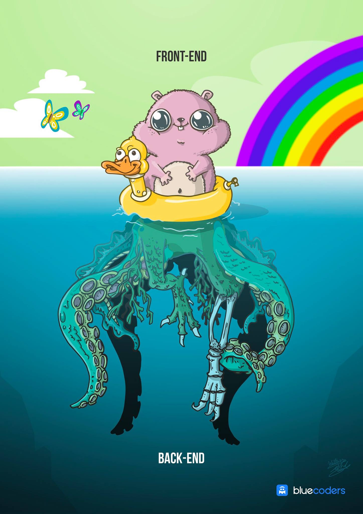
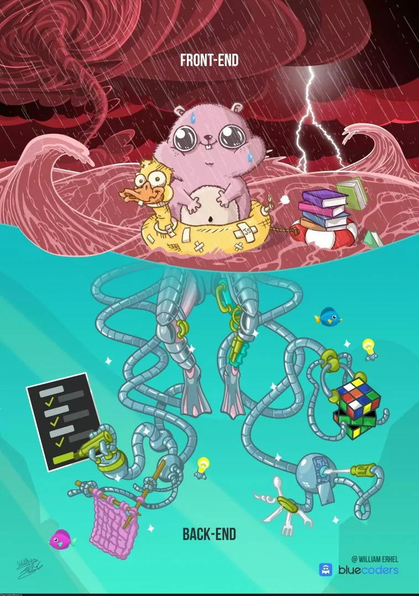

<!--
author:   Andrea Charão

email:    andrea@inf.ufsm.br

version:  0.0.1

language: PT-BR

narrator: Brazilian Portuguese Female

comment:  Material de apoio para a disciplina
          ELC1090 - Desenvolvimento de Software para Web
          da Universidade Federal de Santa Maria

translation: English  translations/English.md
-->

<!--
liascript-devserver --input README.md --port 3001 --live
https://liascript.github.io/course/?https://raw.githubusercontent.com/AndreaInfUFSM/elc1090-2026b/master/classes/26/README.md
-->

# Projeto final

> **Objetivo:** demonstrar avanço em conhecimentos e práticas de desenvolvimento web em relação aos projetos anteriores.

 
 
 

## Requisitos

- Desenvolvimento individual ou em dupla.
- Continuar um projeto anterior **ou** iniciar outro que permita preencher lacunas de aprendizado e/ou explorar soluções e tecnologias diferentes.
- Definir um avanço relevante, considerando a experiência e os projetos já realizados.
- Negociar o escopo com a professora e demonstrar uma aplicação funcional.

## Possibilidades de avanço

Algumas sugestões, não obrigatórias:

- **Login federado:** autenticação com provedor de identidade (Google, Microsoft, Meta, GitHub ou outro).
- **APIs externas:** integração com serviços de IA para geração de textos ou outros conteúdos, ou com APIs de dados e funcionalidades.
- **Novas tecnologias:** experimentar outra linguagem, framework, banco de dados ou arquitetura.
- **Funcionalidades mais elaboradas:** ampliar regras de negócio, permissões, interações ou experiências de uso.
- **Qualidade de software:** aprofundar testes, segurança, acessibilidade, desempenho ou implantação.
- **Interação externa:** interagir com cliente/usuário/equipe como parte do desenvolvimento

## Desenvolvimento

- Registrar a proposta, o avanço pretendido e as tecnologias escolhidas.
- Desenvolver incrementalmente, com commits frequentes e versões funcionais.
- Testar e publicar a aplicação em infraestrutura gratuita, sempre que aplicável.
- Documentar decisões, dificuldades, uso de IA e evidências de aprendizagem no README.

## Quadro compartilhado de propostas

Este documento compartilhado vai manter um registro das propostas e comentários de validação:

https://docs.google.com/document/d/19NqZBPJfvTZVw6NtvZXMz6HvJtxwl0Ewf3CPGafoxQc/edit?usp=sharing

⚠️ **ATENÇÃO!** Edição permitida até o prazo final para propostas (03/11).

## Tecnologias possíveis

As tecnologias continuam de livre escolha e devem permitir **deploy gratuito** durante a disciplina.

Algumas possibilidades:

- **Java:** [Spring Boot](https://spring.io/projects/spring-boot), [Spring Security](https://spring.io/projects/spring-security)
- **Python:** [Flask](https://flask.palletsprojects.com/), [FastAPI](https://fastapi.tiangolo.com/), [Django](https://www.djangoproject.com/)
- **JavaScript / TypeScript:** [Express](https://expressjs.com/), [Fastify](https://fastify.dev/), [NestJS](https://nestjs.com/)
- **PHP:** [Laravel](https://laravel.com/)
- **Bancos relacionais:** [SQLite](https://www.sqlite.org/), [PostgreSQL](https://www.postgresql.org/), [MySQL](https://www.mysql.com/)
- **Bancos não relacionais:** [MongoDB](https://www.mongodb.com/)
- **ORM / acesso a dados:** [Hibernate](https://hibernate.org/), [SQLAlchemy](https://www.sqlalchemy.org/), [Prisma](https://www.prisma.io/)
- **Backend/autenticação como serviço:** [Supabase](https://supabase.com/), [Firebase](https://firebase.google.com/), [PocketBase](https://pocketbase.io/)
- **Hospedagem / deploy:** [Render](https://render.com/), [Vercel](https://vercel.com/), [Netlify](https://www.netlify.com/), [Railway](https://railway.com/)

Outras tecnologias podem ser utilizadas, desde que atendam aos requisitos.

### Observações

- A aplicação deve continuar funcionando após a entrega, para que possa ser testada e inspecionada durante a disciplina

## Entrega

- Utilizar o repositório de entrega da organização: [elc1090](https://github.com/orgs/elc1090/repositories) (criação do repositório será feita pela professora após definição de trabalho em dupla/individual)
- Preencher o README.md a partir do [template](assets/README.template.md), destacando o avanço em relação aos projetos anteriores
- Disponibilizar o código e instruções para execução/testes.
- Apresentar o projeto em cerca de **5 minutos**, com ênfase no processo, nas decisões e no aprendizado.

**Prazos**:

- Definição da proposta: até dia **03/11 (terça-feira)**.
- Entrega até **23/11 (segunda-feira)**, apresentações dias **24 e 26/11 (terça e quinta-feira)**.

Obs.:
- Será publicada uma escala de apresentações, que deverá ser respeitada.
- Trabalhos não apresentados ficarão sujeitos a penalidade na nota, podendo inclusive ter a nota zerada.

## Avaliação

Rubricas de avaliação

<!-- data-type="none" -->
| Descrição   | Nota   |
| :--------- | :--------- |
| Projeto alinhado com os objetivos, requisitos e demandas negociadas, com evidente empenho e aprendizado no processo | 10 a 12 |
| Projeto / compreensão com algumas limitações, mas com evidente empenho e aprendizado no processo | 7 a 9 |
| Projeto / compreensão com muitas limitações, mas mesmo assim demonstrando algum empenho no processo | 5 a 7 |
| Trabalho não entregue, ou com indícios de desonestidade acadêmica, ou feito de última hora (sem evidências de empenho e atenção às especificações) | 0 a 5 |

