<!--
author:   Andrea Charão

email:    andrea@inf.ufsm.br

version:  0.0.1

language: PT-BR

narrator: Brazilian Portuguese Female

comment:  ELC1090 - Desenvolvimento de Software para Web
          Universidade Federal de Santa Maria

link:     https://cdn.jsdelivr.net/gh/AndreaInfUFSM/elc1090-2026b@main/assets/css/custom.css

import: https://raw.githubusercontent.com/liaScript/mermaid_template/master/README.md
-->

<!--
liascript-devserver --input README.md --port 3001 --live
https://liascript.github.io/course/?https://raw.githubusercontent.com/AndreaInfUFSM/elc1090-2026b/master/classes/27/README.md
-->

# Arquiteturas web e fluxos de interação: estudo de casos

> Onde cada parte executa? Quem se comunica com quem? O que acontece depois de uma ação do usuário?

Casos:
- Site estático, WordPress, reserva de salas e loja virtual.
- Analisar casos ajuda a reconhecer estruturas recorrentes e aplicá-las a outros contextos.

## Duas visões complementares

| Visão | Pergunta | Representação |
| --- | --- | --- |
| Arquitetura | Quais são as partes, suas responsabilidades e conexões? | Aplicações, armazenamentos e sistemas externos |
| Interação | Como essas partes colaboram em uma operação? | Participantes, mensagens e ordem temporal |

Observações:

- Um diagrama de arquitetura não mostra necessariamente a ordem de execução.
- Um diagrama de interação descreve **um cenário**, não todas as possibilidades da aplicação.

### Referência: C4 e UML

- As visões de arquitetura desta aula usam conceitos do [modelo C4](https://c4model.com/): pessoas, sistemas, aplicações e armazenamentos, com responsabilidades e relações explícitas.

  - No C4, uma aplicação ou armazenamento pode ser chamado de *container*. Aqui, usaremos diretamente os nomes e tipos das partes para evitar confusão com containers Docker.

- Os fluxos usam um subconjunto dos diagramas de sequência da [UML](https://www.omg.org/spec/UML/) (*Unified Modeling Language*), também aceitos como estilo de diagrama dinâmico no C4.

  - Não é preciso estudar toda a UML para ler estes exemplos.

### Como ler os diagramas

- Caixas identificam nome, tipo e responsabilidade.
- Cilindros representam bancos de dados.
- Contornos agrupam partes de um sistema.
- Setas da arquitetura indicam relações; seus rótulos explicam a comunicação.
- Nos diagramas de sequência, o tempo avança de cima para baixo.
- Setas contínuas mostram solicitações; tracejadas mostram respostas.
- Uma seta para o próprio participante representa processamento interno.

## Caso 1: Portfólio ou site de disciplina

- Um site público apresenta páginas, imagens e links. 
- Não há cadastro nem dados compartilhados que precisem ser alterados pelos visitantes.
- Os arquivos HTML, CSS e JavaScript estão em uma hospedagem estática.

### Portfólio: arquitetura

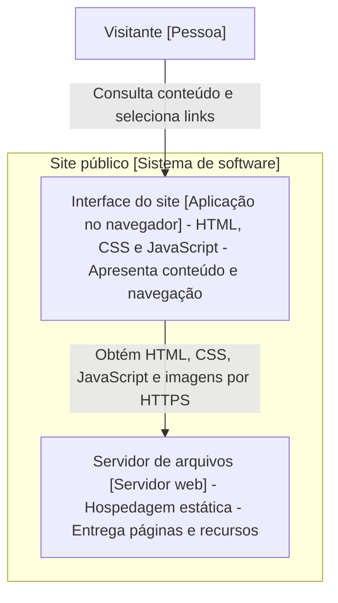

- A caixa da interface representa código que executa no navegador.
- A hospedagem entrega os arquivos que permitem essa execução.

### Portfólio: abrir uma página

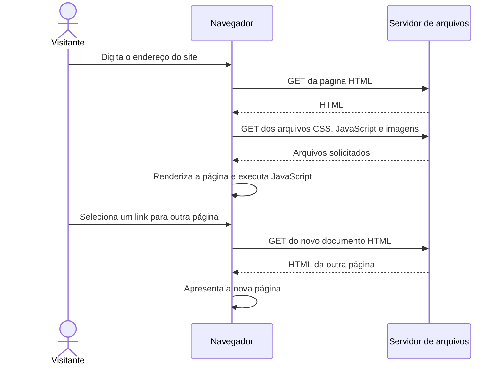

- O navegador aparece explicitamente porque precisa obter a interface antes de executá-la. 
- O cenário considera várias páginas HTML, com cache inicialmente vazio.

### Quiz 1: site estático

Um portfólio hospedado como arquivos estáticos executa JavaScript para filtrar os projetos exibidos. Onde esse filtro pode executar?

[( )] No banco de dados da hospedagem
[( )] No servidor, obrigatoriamente
[( )] No processo de resolução de DNS
[(X)] No navegador do visitante
[[?]] Considere que os projetos já foram carregados e o filtro apenas altera o que aparece na página.

### Quiz 2: hospedagem e execução

Os arquivos de um frontend criado com React são entregues por um servidor Nginx em um container Docker. Onde o JavaScript dessa interface executa, depois de carregado pelo visitante?

[( )] No Nginx que entregou os arquivos
[( )] No banco de dados do site
[(X)] No navegador do visitante
[( )] No Docker do servidor, necessariamente

## Caso 2: Site com WordPress

- Um portal publica notícias. 
- Editores entram na área administrativa para escrever as notícias.
- Visitantes leem o conteúdo público.

Neste exemplo, o WordPress gera páginas HTML no servidor, usando conteúdo do banco e a apresentação definida pelo tema.

### WordPress: arquitetura

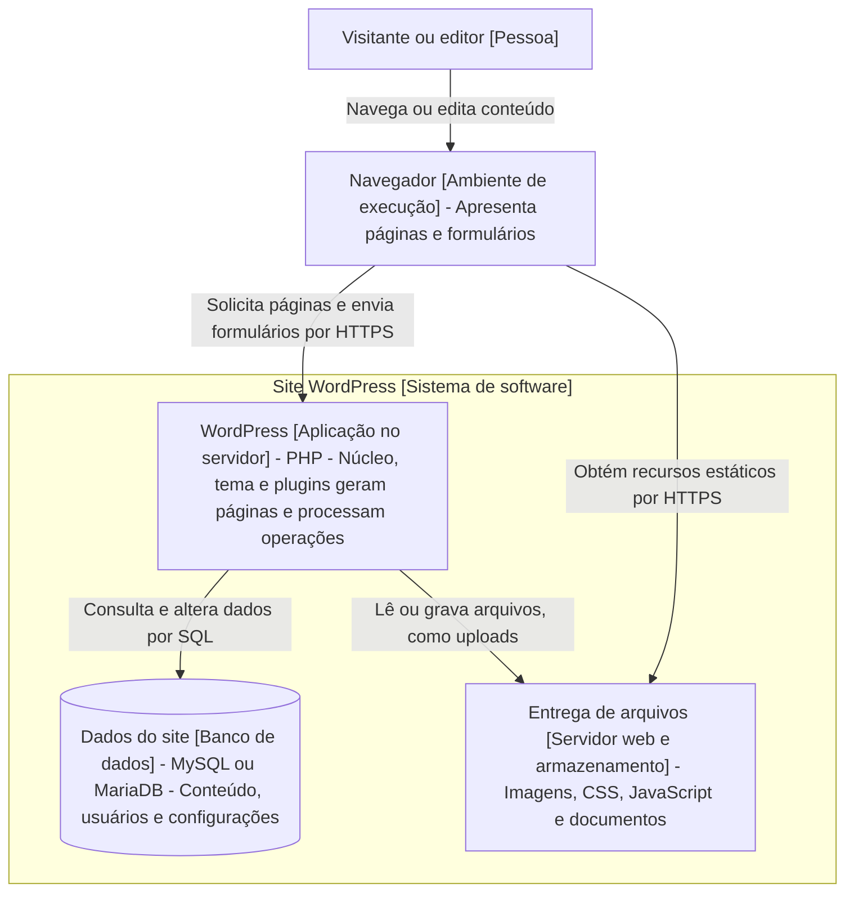

- A entrega de arquivos foi agrupada para simplificar. 
- O navegador recebe arquivos por um servidor web; não acessa diretamente o sistema de arquivos.
- Núcleo, tema e plugins normalmente executam dentro da mesma aplicação PHP. Suas responsabilidades diferentes não os tornam serviços independentes.

### WordPress: ler uma notícia

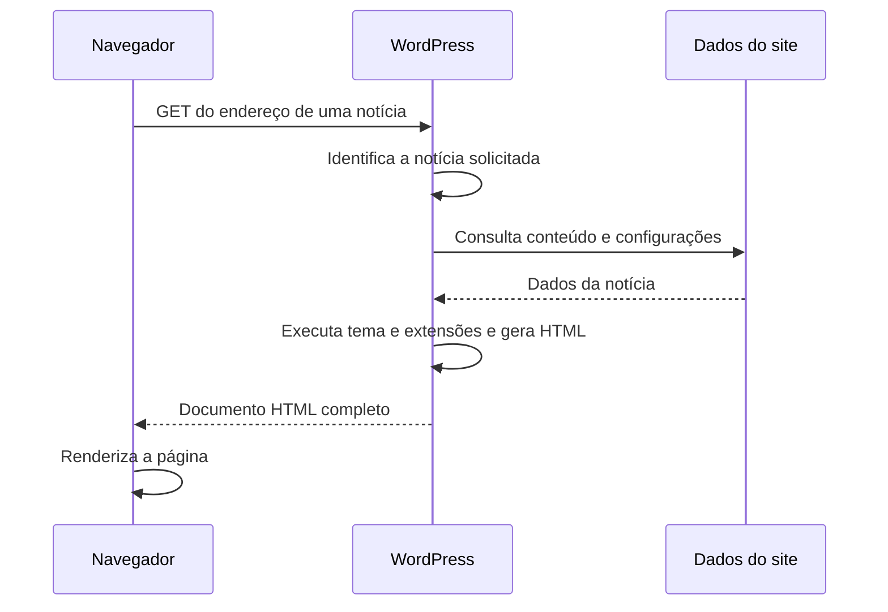

Observações: 
- Cenário simplificado, sem cache de página. 
- Imagens, CSS e JavaScript são solicitados separadamente, como no primeiro caso.

### HTML gerado onde?

| Site estático do primeiro caso | WordPress convencional |
| --- | --- |
| HTML já existe como arquivo publicado | HTML pode ser produzido pelo PHP a cada requisição |
| Alterações podem exigir nova publicação dos arquivos | Editores alteram conteúdo pela aplicação |
| Não exige banco de dados em execução para servir páginas | Usa banco de dados para conteúdo e configurações |

Cache pode permitir que o WordPress entregue HTML já produzido, sem repetir toda a geração.

### Quiz 3: WordPress e SPA (*Single Page Application*)

Um site WordPress convencional carrega um documento HTML completo ao abrir outra notícia. Como descrever essa navegação?

[( )] SPA, porque o site também possui JavaScript
[(X)] Navegação entre páginas, com HTML gerado no servidor
[( )] Acesso direto do navegador ao MySQL
[( )] Navegação exclusivamente local, sem requisição
[[?]] Observe se a navegação troca o documento ou apenas atualiza partes da interface existente.

### Variação: WordPress como backend de conteúdo

- WordPress também pode expor conteúdo por sua API REST para ser consumida por uma interface (frontend) separada.

- Essa organização é conhecida como *WordPress headless*.

- A presença de uma API não transforma automaticamente o site em SPA. Isso depende de como a interface implementa a navegação.

### WordPress: login padrão

Outra variação, independente da separação entre frontend e backend, é a forma de autenticar os usuários.

No login padrão, o WordPress verifica a senha da conta cadastrada no próprio site.

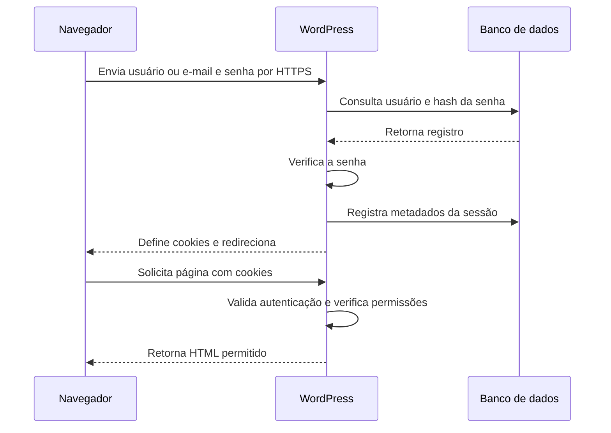

### WordPress: login com Google

- Na arquitetura, acrescentamos o Google como sistema externo. 
- O plugin **Nextend Social Login** executa dentro do WordPress, sem exigir outro servidor.
- Cenário simplificado: conta Google já vinculada a um usuário local.

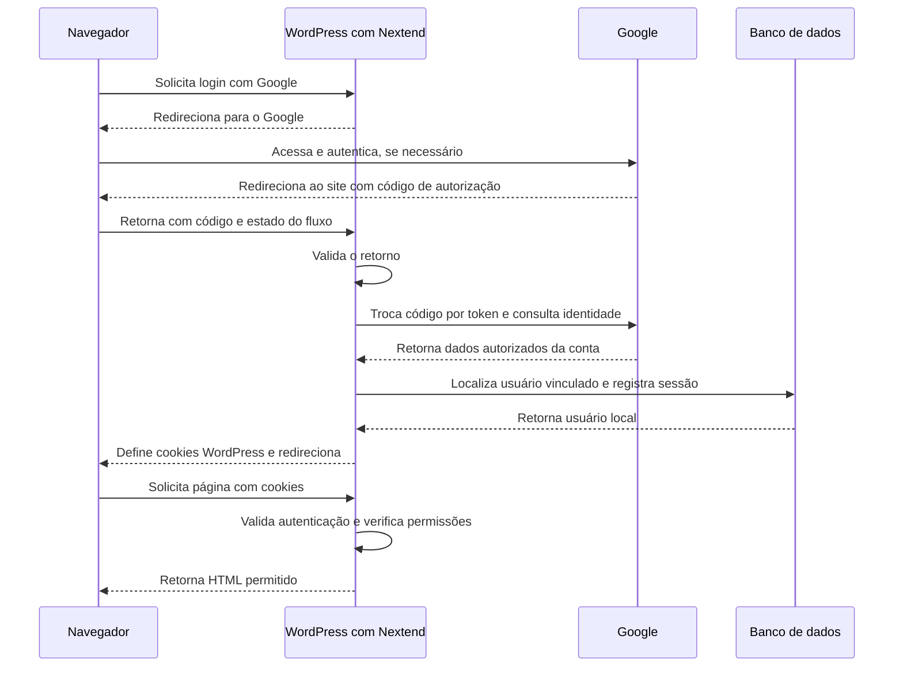

> Google autentica a conta Google; WordPress mantém a conta local e decide suas permissões. Nos dois caminhos, as requisições seguintes usam os cookies do WordPress.

### Extra: PHP2Shell (segurança além do login)

Em outubro de 2026, pesquisadores da Wiz divulgaram falhas no **próprio PHP**, demonstrando execução remota de código **sem autenticação** em instalações vulneráveis de WordPress, Drupal e Joomla.

- As falhas envolviam gerenciamento de memória e tratamento de erros.
- O problema estava no ambiente que executa a aplicação, não necessariamente no código do site.
- A correção exige atualizar o PHP; adicionar login com Google não resolve essa vulnerabilidade.

> Autenticação protege operações da aplicação, mas a segurança também depende das camadas que a executam.

Para discutir: no nosso diagrama do WordPress, onde essa vulnerabilidade estaria? Por que uma tela de login não impediria sua exploração?

Fonte: [PHP2Shell: AI uncovers critical RCE vulnerabilities affecting 70% of the Internet](https://www.wiz.io/blog/php2shell-php-rce).

## Caso 3: Reserva de salas

- Usuários entram no sistema, consultam disponibilidade e reservam salas. 
- Cada reserva pertence a um usuário.
- Neste exemplo, uma interface JavaScript chama uma API própria.
- O mesmo backend também entrega os arquivos da interface.

### Reservas: arquitetura

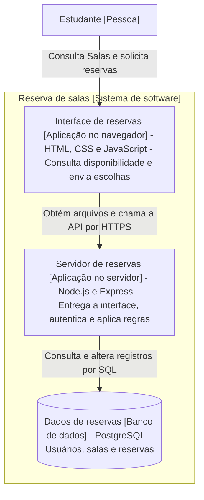

### Reservas: entrar no sistema

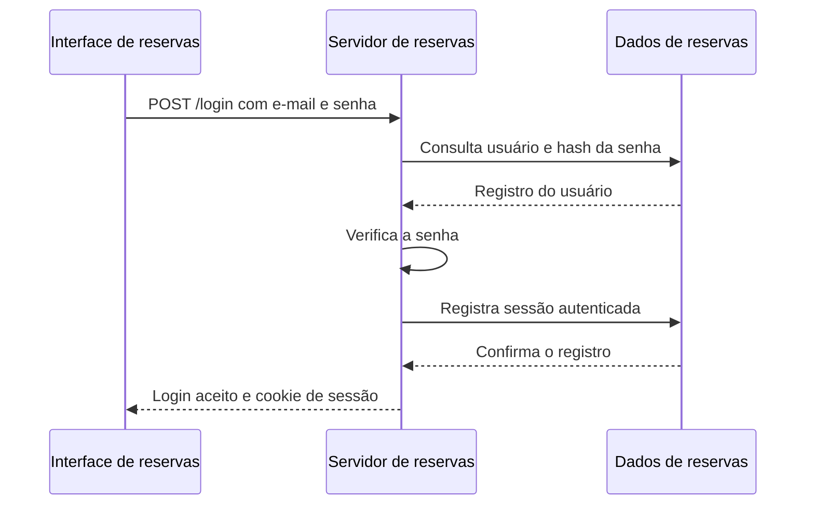

- Este exemplo usa sessões mantidas no servidor. 
- O navegador envia o cookie nas requisições seguintes, conforme as regras do cookie e da requisição.

### Reservas: consultar e reservar

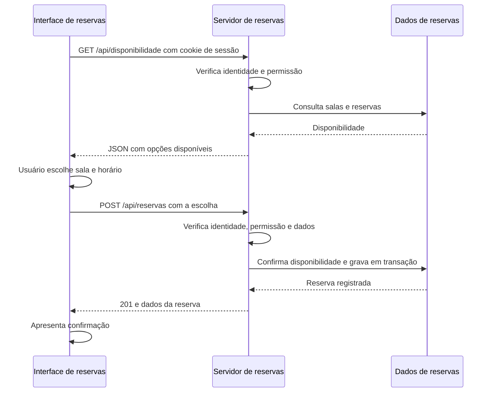

- O diagrama mostra o caminho de sucesso. 
- A transação e as regras do banco precisam impedir reservas conflitantes.

### Quiz 4: disponibilidade

Dois usuários visualizam o mesmo horário livre. Um deles confirma primeiro. O que o sistema precisa fazer quando o segundo tenta confirmar?

[( )] Aceitar, pois o horário estava livre na tela
[( )] Confiar no JavaScript para detectar o conflito
[( )] Criar outra reserva e esconder a primeira
[(X)] Verificar novamente e impedir a reserva conflitante
[[?]] A consulta e a confirmação são requisições diferentes, separadas no tempo.

### Quiz 5: regras de acesso

A interface esconde o botão de cancelar reservas de outros usuários. Onde a permissão de cancelamento ainda precisa ser garantida?

[(X)] No backend que processa o cancelamento
[( )] Apenas no CSS que esconde o botão
[( )] Apenas no navegador que criou a reserva
[( )] Apenas na documentação da API

## Caso 4: Loja virtual

- Clientes consultam produtos, montam um carrinho, escolhem frete e pagam um pedido.

- A loja usa serviços externos para frete e pagamento, além de armazenamento separado para imagens.

- É uma visão simplificada de uma aplicação maior. **Mais usuários não implicam, por si só, mais serviços ou microserviços.**

### Loja virtual: arquitetura

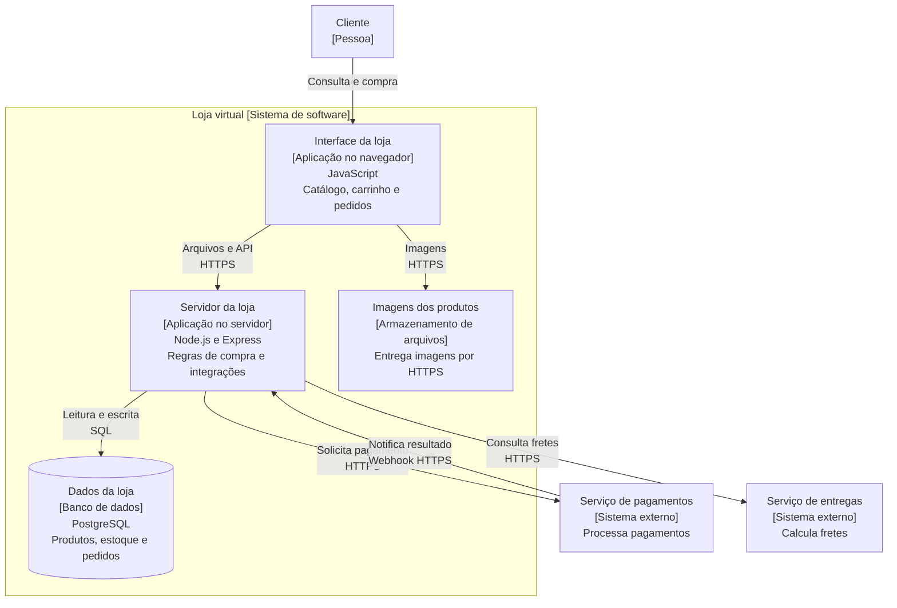

### Loja: catálogo e frete

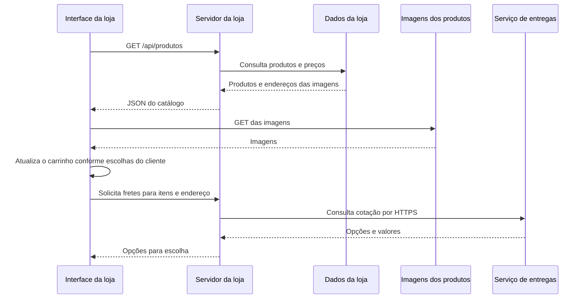

Neste cenário, o carrinho é mantido na interface até o envio do pedido. Outras lojas podem persistir o carrinho no backend.

### Loja: iniciar pagamento

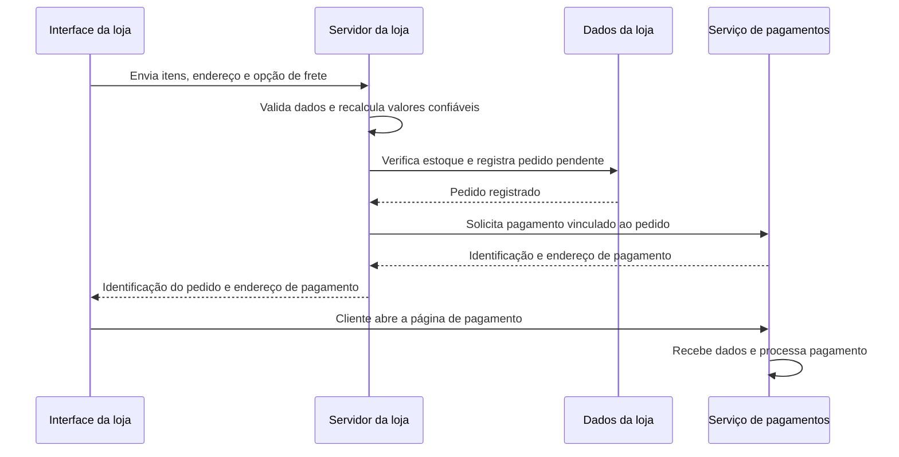

O exemplo usa uma página de pagamento do provedor. Os dados do cartão não precisam passar pelo servidor da loja.

### Loja: resultado do pagamento

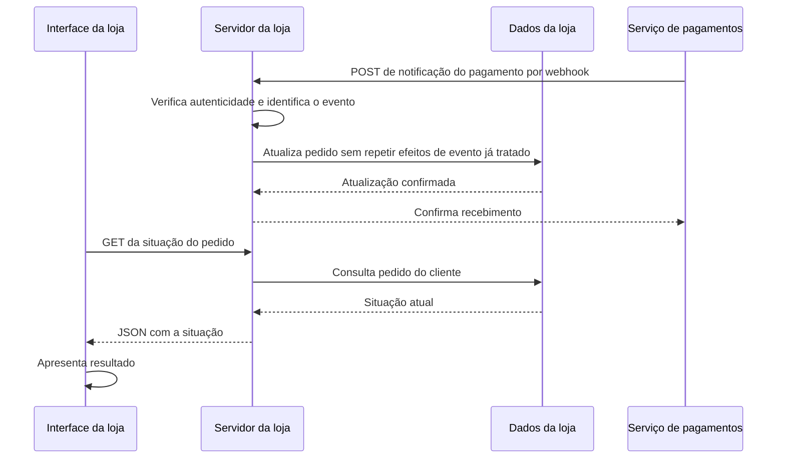

A consulta pode ocorrer antes da notificação: nesse momento, o pedido ainda pode estar pendente. O diagrama mostra uma ordem possível.

### Quiz 6: quem é cliente?

Quando o servidor da loja envia uma requisição HTTP ao serviço de entregas, qual papel desempenha nessa interação?

[( )] Navegador do consumidor
[(X)] Cliente HTTP do serviço de entregas
[( )] Banco de dados da transportadora
[( )] Servidor HTTP que recebe a cotação

### Quiz 7: confirmação de pagamento

O navegador retorna da página de pagamento com um parâmetro indicando sucesso. Isso, sozinho, basta para marcar o pedido como pago?

[( )] Sim, pois o parâmetro veio pela navegação
[( )] Sim, se o botão de pagamento desapareceu
[(X)] Não; o backend deve verificar o resultado com uma fonte confiável do provedor
[( )] Não; pagamentos só podem ser confirmados manualmente
[[?]] Considere quem controla os dados enviados pelo navegador.

### Quiz 8: webhook

O serviço de pagamentos envia uma notificação HTTP ao servidor da loja. Quem inicia essa requisição?

[( )] O navegador do cliente
[( )] O banco de dados da loja
[( )] O servidor da loja
[(X)] O serviço de pagamentos

## Comparando os quatro casos

| Caso | Origem principal do HTML | Dados persistentes | Integrações destacadas |
| --- | --- | --- | --- |
| Portfólio | Arquivos publicados | Arquivos do site | Nenhuma neste exemplo |
| WordPress | PHP no servidor | Banco e arquivos | Plugins, conforme o site |
| Reservas | Interface entregue como arquivos | Banco de dados | API própria |
| Loja | Interface entregue como arquivos | Banco e imagens | Pagamento e frete |

A mesma arquitetura pode usar outras linguagens e frameworks. E o mesmo framework pode participar de arquiteturas diferentes.

### Quiz 9: uma ou várias páginas?

Uma interface chama uma API para buscar produtos. Podemos concluir que ela é uma SPA?

[( )] Sim, toda chamada de API caracteriza uma SPA
[( )] Sim, desde que a resposta seja JSON
[(X)] Não; é preciso observar como a navegação entre telas acontece
[( )] Não; SPAs não podem usar APIs próprias

## Referências

- [Modelo C4: visão de aplicações e armazenamentos](https://c4model.com/diagrams/container)
- [Modelo C4: diagramas dinâmicos e estilo de sequência](https://c4model.com/diagrams/dynamic)
- [Modelo C4: recomendações de notação](https://c4model.com/diagrams/notation)
- [WordPress: temas](https://developer.wordpress.org/themes/)
- [WordPress: plugins e hooks](https://developer.wordpress.org/plugins/hooks/)
- [WordPress: API REST](https://developer.wordpress.org/rest-api/)

